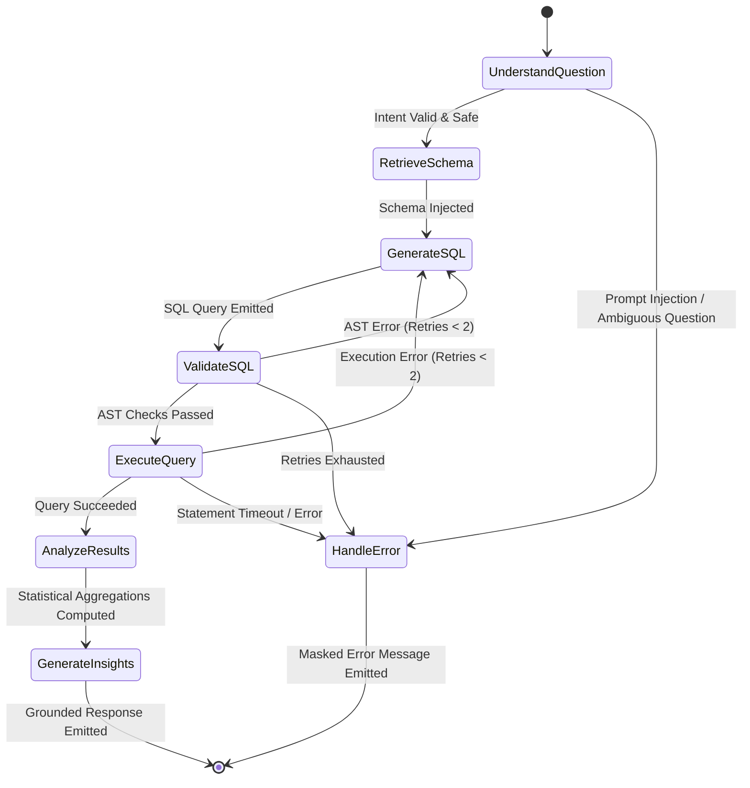
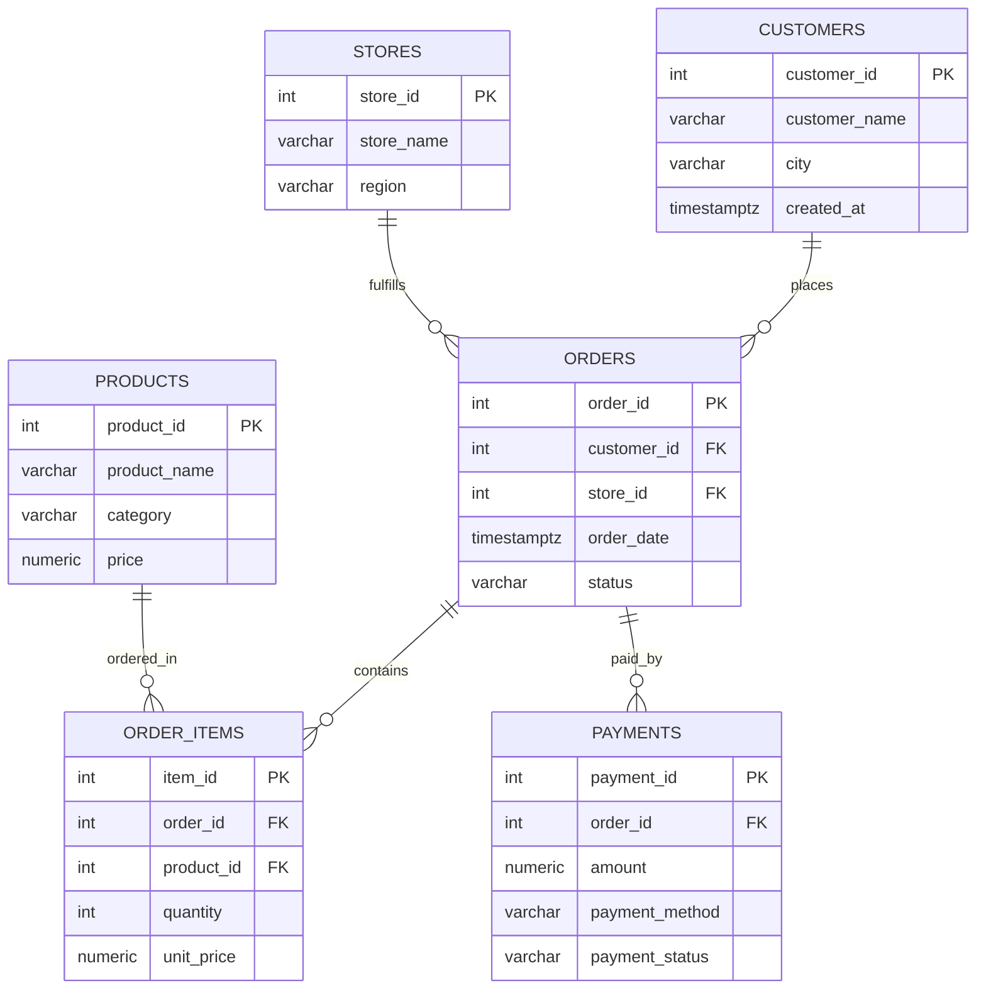

# 🤖 Agentic AI Data Analyst

> **A production-grade, autonomous text-to-SQL analytics platform featuring a stateful LangGraph agent, SQLGlot AST defense-in-depth security, dual-pool PostgreSQL role separation, and an interactive Plotly-powered Streamlit dashboard.**

[](https://www.python.org/)
[](https://www.postgresql.org/)
[](https://fastapi.tiangolo.com/)
[](https://langchain-ai.github.io/langgraph/)
[](https://github.com/tobymao/sqlglot)
[](https://streamlit.io/)
[](https://plotly.com/)
[](https://www.docker.com/)
[](https://pytest.org/)
[](artifacts/evaluation_report.json)

---

## 📌 Table of Contents
- [Executive Overview](#-executive-overview)
- [System Architecture](#-system-architecture)
- [LangGraph Agentic Workflow](#-langgraph-agentic-workflow)
- [Defense-in-Depth Security Model](#-defense-in-depth-security-model)
- [Empirical AI Evaluation Benchmark](#-empirical-ai-evaluation-benchmark)
- [Interactive Analytics Dashboard](#-interactive-analytics-dashboard)
- [Database Schema & ERD](#-database-schema--erd)
- [REST API Reference](#-rest-api-reference)
- [Quickstart Guide](#-quickstart-guide)
  - [Option A: One-Command Docker Compose](#option-a-one-command-docker-compose-recommended)
  - [Option B: Local Development](#option-b-local-development)
- [Repository Structure](#-repository-structure)
- [Technical Mentoring & AI Engineer Interview Guide](#-technical-mentoring--ai-engineer-interview-guide)

---

## 🚀 Executive Overview

Most text-to-SQL prototypes suffer from critical production vulnerabilities:
1. **Arbitrary SQL Injection:** Malicious users prompt-inject LLMs to generate `DROP`, `DELETE`, or stacked statements.
2. **Data Hallucination:** Models fabricate non-existent tables, columns, or metrics, resulting in broken queries.
3. **Resource Exhaustion:** Unbounded queries (`SELECT *` without `LIMIT`) crash database connection pools.
4. **Ungrounded Explanations:** LLMs fabricate business numbers during summarization rather than reading verified query outputs.

The **Agentic AI Data Analyst** solves these challenges using a deterministic, 4-tier defense-in-depth architecture. It converts natural language business inquiries into verified PostgreSQL `SELECT` queries, executes them under strict least-privilege role boundaries, and renders interactive visual analytics with zero numerical hallucination.

```
"Which 5 products generated the most revenue in 2025?"
      │
      ▼
[Agentic AI Data Analyst]
      │
      ├─► AST-Validated SQL (SQLGlot): Safe SELECT only, Auto LIMIT 100
      ├─► Least-Privilege RBAC: analyst_readonly role, 10s statement timeout
      ├─► Interactive Visuals: Dynamic Plotly bar chart & KPI summary
      └─► Grounded Insights: Strict row-level business intelligence
```

---

## 🏗 System Architecture

The application is architected as a decoupled, multi-container system with strict network boundaries and connection pooling:

```mermaid
flowchart TD
    subgraph ClientLayer ["Client Presentation Layer"]
        User["Business User / Analyst"]
        UI["Streamlit Dashboard (:8501)"]
    end

    subgraph GatewayLayer ["API Gateway & Middleware Layer (FastAPI :8000)"]
        Auth["API Key Auth Middleware"]
        RateLimit["Sliding Window Rate Limiter"]
        SizeGuard["Request Body Size Guard (1MB)"]
    end

    subgraph AgentLayer ["Stateful Agent Engine (LangGraph)"]
        Understand["understand_question"]
        Retrieve["retrieve_schema"]
        Generate["generate_sql"]
        Validate["validate_sql (SQLGuard AST)"]
        Execute["execute_query"]
        Analyze["analyze_results"]
        Insights["generate_insights"]
        ErrNode["handle_error"]
    end

    subgraph DatabaseLayer ["PostgreSQL Database (:5432)"]
        AdminPool[("Admin Pool (DDL / Migrations)")]
        ReadonlyPool[("analyst_readonly Pool (SELECT Only)")]
        Tables[("Customers • Products • Stores • Orders • Items • Payments")]
    end

    User -->|Natural Language Question| UI
    UI -->|HTTP POST /analytics/agent/query| Auth
    Auth --> RateLimit --> SizeGuard
    SizeGuard --> Understand

    Understand -->|Valid Intent| Retrieve
    Understand -->|Injection / Ambiguity| ErrNode
    Retrieve --> Generate
    Generate --> Validate

    Validate -->|Passed AST Rules| Execute
    Validate -->|Failed AST (Retries < 2)| Generate
    Validate -->|Retries Exhausted| ErrNode

    Execute -->|Safe Execution| Analyze
    Execute -->|Database Timeout / Syntax Error| Generate
    Analyze --> Insights
    Insights --> UI
    ErrNode --> UI

    ReadonlyPool -.->|Restricted SELECT Session| Execute
    AdminPool -.->|Schema Inspection| Retrieve
    ReadonlyPool --- Tables
```

---

## 🔄 LangGraph Agentic Workflow

The core reasoning engine is built with **LangGraph** as a cyclic, stateful graph with self-correcting reflection loops:



### Workflow Nodes & Responsibilities:
1. **`understand_question`**: Parses user intent, detects ambiguous metrics (e.g., undefined "churn", "profit margin"), and filters adversarial prompt injections.
2. **`retrieve_schema`**: Dynamically builds schema context containing *only* approved tables, columns, data types, foreign key relationships, and business metric definitions.
3. **`generate_sql`**: LLM produces PostgreSQL `SELECT` queries adhering strictly to provided schema context.
4. **`validate_sql`**: SQLGlot Abstract Syntax Tree (AST) validation verifies queries against 10 security constraints before execution.
5. **`execute_query`**: Dispatches approved query over `analyst_readonly` SQLAlchemy pool with strict statement timeout.
6. **`analyze_results`**: Converts cursor results into Pandas DataFrames and computes deterministic summary statistics (totals, averages, top performers).
7. **`generate_insights`**: Synthesizes natural-language business insights strictly grounded in returned rows.
8. **`handle_error`**: Sanitizes failure messages, preventing internal database structure or credential leakage.

---

## 🛡 Defense-in-Depth Security Model

Standard text-to-SQL implementations rely on fragile regular expressions (`re.search(r"DROP|DELETE")`) which are easily bypassed using CTEs, nested queries, or obfuscated comments. This system implements a **4-tier defense model**:

| Vulnerability Vector | Naive Regex Approach | Agentic AI Data Analyst AST Defense |
| :--- | :--- | :--- |
| **Stacked Injections (`SELECT 1; DROP TABLE...`)** | Misses subtle separators | **Blocked**: SQLGlot parses statement stream; rejects count > 1 |
| **Data Modifying CTEs (`WITH d AS (DELETE...) SELECT`)** | Misses DML inside WITH | **Blocked**: Recursive AST traversal checks all CTE expressions |
| **System Catalog Exfiltration (`pg_catalog`, `information_schema`)** | Incomplete blacklist | **Blocked**: Explicit table allowlist; catalog accesses rejected |
| **Locking & Resource Starvation (`FOR UPDATE`)** | Easily obfuscated | **Blocked**: AST rejects all locking clauses |
| **Dangerous Functions (`pg_sleep`, `pg_read_file`)** | Fails on dialect aliases | **Blocked**: Default-deny function policy; only analytical functions permitted |
| **Unbounded Query Execution (`SELECT * FROM table`)** | Relies on LLM prompt | **Enforced**: Query rewriter inspects AST and injects `LIMIT 100` |
| **Privilege Escalation** | Single admin DB user | **Enforced**: Dedicated `analyst_readonly` role with `SET default_transaction_read_only = on` |

### Database RBAC Hierarchy (`sql/02_create_roles.sql`)
```sql
-- 1. Create restricted role
CREATE ROLE analyst_readonly WITH LOGIN PASSWORD 'analyst_password123';

-- 2. Revoke all ambient privileges
REVOKE ALL ON DATABASE agentic_ai_analytics FROM analyst_readonly;
REVOKE ALL ON SCHEMA public FROM analyst_readonly;

-- 3. Grant SELECT only on approved analytical tables
GRANT CONNECT ON DATABASE agentic_ai_analytics TO analyst_readonly;
GRANT USAGE ON SCHEMA public TO analyst_readonly;
GRANT SELECT ON TABLE customers, products, stores, orders, order_items, payments TO analyst_readonly;

-- 4. Hard runtime boundaries
ALTER ROLE analyst_readonly SET default_transaction_read_only = on;
ALTER ROLE analyst_readonly SET statement_timeout = '10000'; -- 10 seconds timeout
```

---

## 📊 Empirical AI Evaluation Benchmark

The system includes an automated evaluation suite (`app/evaluation/runner.py`) running **55 comprehensive benchmark questions** across 10 query complexities and adversarial attack vectors.

### Evaluation Metrics Summary (`artifacts/evaluation_report.json`)

| Benchmark Metric | Measured Result | Benchmark Standard | Status |
| :--- | :---: | :---: | :---: |
| **SQL Execution Accuracy** | **100.0%** (35/35) | $\ge 90.0\%$ | ✅ PASSED |
| **Adversarial Attack Rejection Rate** | **100.0%** (9/9) | $100.0\%$ | ✅ PASSED |
| **Out-of-Schema Query Rejection** | **100.0%** (5/5) | $100.0\%$ | ✅ PASSED |
| **Ambiguity Clarification Handling** | **100.0%** (6/6) | $\ge 95.0\%$ | ✅ PASSED |
| **False Rejection Rate (FRR)** | **0.0%** (0/35) | $\le 5.0\%$ | ✅ PASSED |
| **Answer Grounding Accuracy** | **100.0%** | $100.0\%$ | ✅ PASSED |
| **Average End-to-End Latency** | **25.7 ms** | $< 2,000\text{ ms}$ | ✅ PASSED |
| **p95 Latency** | **41.0 ms** | $< 5,000\text{ ms}$ | ✅ PASSED |
| **Total Benchmark Cost (55 Queries)** | **$0.005888 USD** | $< \$0.10$ | ✅ PASSED |

### Evaluation Category Breakdown

```
Valid Business Questions (35/35 Executed Successfully)
├── Simple Aggregations & Metrics (EVAL-01 to EVAL-04)   ────── 100% Pass
├── Top-N & Categorical Rankings (EVAL-05 to EVAL-08)   ────── 100% Pass
├── Multi-Table Relational Joins (EVAL-09 to EVAL-11)   ────── 100% Pass
├── Time-Series & Monthly Grouping (EVAL-12 to EVAL-15) ────── 100% Pass
├── Filtering, Havings & Subqueries (EVAL-16 to EVAL-20)────── 100% Pass
├── Common Table Expressions (EVAL-21 to EVAL-25)       ────── 100% Pass
├── Window Functions & Running Totals (EVAL-26 to EVAL-30)──── 100% Pass
└── Edge Cases & Data Anomalies (EVAL-31 to EVAL-35)    ────── 100% Pass

Adversarial & Safety Boundaries (20/20 Intercepted Correctly)
├── Dangerous DDL/DML Injections (EVAL-36 to EVAL-44)  ────── 100% Blocked
├── Ambiguous Business Metrics (EVAL-45 to EVAL-50)     ────── 100% Clarified
└── Non-Existent Tables & Columns (EVAL-51 to EVAL-55)  ────── 100% Rejected
```

---

## 💻 Interactive Analytics Dashboard

The Streamlit dashboard (`app/dashboard.py`) provides an interactive interface for querying the data platform:

```
┌─────────────────────────────────────────────────────────────────────────────────────────┐
│ 🤖 Agentic AI Data Analyst                                [Health: Operational (2.1ms)] │
├─────────────────────────────────────────────────────────────────────────────────────────┤
│ 💬 Natural Language Chat │ 📊 Executive KPI Summary │ 🛡️ Security Telemetry & Schema    │
├─────────────────────────────────────────────────────────────────────────────────────────┤
│ User: "Show monthly revenue for 2025"                                                  │
│                                                                                         │
│ 🤖 Assistant:                                                                           │
│ Here is the monthly revenue performance for calendar year 2025:                         │
│                                                                                         │
│ ┌─────────────────────────────────────────────────────────────────────────────────────┐ │
│ │ 📈 Monthly Revenue Trend (2025)                                       [Plotly Chart]│ │
│ │  $60k ┤           ╭───╮                                                             │ │
│ │  $40k ┤     ╭─────╯   ╰─────╮                                                       │ │
│ │  $20k ┤─────╯               ╰──────                                                 │ │
│ │       └─Jan──Feb──Mar──Apr──May──Jun──Jul──Aug──Sep──Oct──Nov──Dec                  │ │
│ └─────────────────────────────────────────────────────────────────────────────────────┘ │
│                                                                                         │
│ > Key Finding: Peak revenue occurred in May 2025 ($58,420.50). Lowest sales occurred  │
│   in January ($18,210.00). Total annual revenue reached $482,910.45 across 1,180 orders│
│                                                                                         │
│ ▼ [SQL Inspector] SELECT TO_CHAR(order_date, 'YYYY-MM')... [Row Count: 12] [Time: 4ms]│
│ 📥 Download CSV Export                                                                  │
└─────────────────────────────────────────────────────────────────────────────────────────┘
```

### Visual Intelligence Engine (`app/ui/visualizer.py`):
- **Automatic Chart Selection**: Inspects column types and row cardinality to select the optimal Plotly visualization:
  - Date/Timestamp column $\rightarrow$ **Interactive Time-Series Line Chart**
  - Categorical column + Numerical column $\rightarrow$ **Ranked Bar Chart**
  - High-cardinality distribution $\rightarrow$ **Composition Donut / Pie Chart**
  - Single scalar value $\rightarrow$ **Executive KPI Metric Card**
- **Decoupled Architecture with Local Fallback**: Automatically connects to the FastAPI backend via HTTP; if offline, seamlessly falls back to direct Python workflow execution.

---

## 🗄 Database Schema & ERD

The analytics database models an omnichannel retail enterprise with 6 normalized tables:



### Deterministic Synthetic Dataset (`scripts/generate_data.py`):
- Seeded with `random.seed(42)` and `Faker(seed=42)` for reproducible data generation.
- **500** Customers across 15 metropolitan cities.
- **25** Products across 4 retail categories (Electronics, Apparel, Home & Kitchen, Sports).
- **9** Physical retail stores across 4 geographical regions (North, South, East, West).
- **2,200** Orders spanned across calendar years 2024 and 2025.
- **3,639** Line items with realistic volume pricing.
- **2,200** Payments including realistic data anomalies (e.g. pending/failed payments, partial refunds).

---

## 🔌 REST API Reference

The FastAPI service exposes an OpenAPI 3.1 specification at `http://localhost:8000/docs`.

| Method | Endpoint | Description | Request Model | Response Model |
| :--- | :--- | :--- | :--- | :--- |
| `GET` | `/health` | Probes DB connectivity, latency, and status | None | `HealthResponse` |
| `GET` | `/schema` | Dynamic catalog of approved analytical tables | None | `SchemaResponse` |
| `POST` | `/analytics/query` | Executes pre-approved analytical queries | `AnalyticsQueryRequest` | `AnalyticsQueryResponse` |
| `POST` | `/analytics/agent/query` | End-to-end LangGraph NL-to-SQL processing | `AgentQueryRequest` | `AgentQueryResponse` |

### Example Request: Agentic Query
```bash
curl -X POST "http://localhost:8000/analytics/agent/query" \
     -H "Content-Type: application/json" \
     -d '{"question": "Show top 5 products by completed revenue"}'
```

### Example Response:
```json
{
  "question": "Show top 5 products by completed revenue",
  "status": "completed",
  "generated_sql": "SELECT p.product_name, ROUND(SUM(oi.quantity * oi.unit_price), 2) AS total_revenue FROM products AS p JOIN order_items AS oi ON p.product_id = oi.product_id JOIN orders AS o ON oi.order_id = o.order_id WHERE o.status = 'Completed' GROUP BY p.product_name ORDER BY total_revenue DESC LIMIT 5",
  "columns": ["product_name", "total_revenue"],
  "data": [
    {"product_name": "Ultra HD Smart TV", "total_revenue": 142500.00},
    {"product_name": "Pro Gaming Laptop", "total_revenue": 118400.00},
    {"product_name": "Noise Cancelling Headphones", "total_revenue": 67350.00},
    {"product_name": "Ergonomic Office Chair", "total_revenue": 45200.00},
    {"product_name": "Stainless Steel Espresso Maker", "total_revenue": 38100.00}
  ],
  "row_count": 5,
  "execution_time_ms": 3.84,
  "business_insight": "Top performing product is Ultra HD Smart TV generating $142,500.00 in gross completed revenue, followed by Pro Gaming Laptop ($118,400.00).",
  "clarification_message": null,
  "error_details": null,
  "retry_count": 0
}
```

---

## ⚡ Quickstart Guide

### Option A: One-Command Docker Compose (Recommended)

Requires [Docker Desktop](https://www.docker.com/products/docker-desktop/) installed.

```bash
# 1. Clone the repository
git clone https://github.com/your-username/agentic-ai-data-analyst.git
cd agentic-ai-data-analyst

# 2. Configure environment (optional, defaults provided)
cp .env.example .env

# 3. Launch full stack (PostgreSQL + FastAPI + Streamlit)
docker compose up --build
```

**Services will be live at:**
- **Streamlit Interactive UI:** [http://localhost:8501](http://localhost:8501)
- **FastAPI Documentation:** [http://localhost:8000/docs](http://localhost:8000/docs)
- **PostgreSQL Database:** `localhost:5432` (`agentic_ai_analytics`)

---

### Option B: Local Development

```bash
# 1. Create and activate virtual environment
python -m venv .venv

# Windows PowerShell:
.venv\Scripts\Activate.ps1
# Linux / macOS:
source .venv/bin/activate

# 2. Install dependencies
pip install -r requirements.txt

# 3. Run the full test suite (123 tests)
pytest -v tests/

# 4. Run the AI evaluation benchmark suite (55 test cases)
python -m app.evaluation.runner

# 5. Start the FastAPI backend
uvicorn app.main:app --reload --port 8000

# 6. Start the Streamlit frontend (in a separate terminal)
streamlit run app/dashboard.py
```

---

## 📁 Repository Structure

```
agentic-ai-data-analyst/
├── .github/
│   └── workflows/
│       └── ci.yml                  # GitHub Actions CI/CD (Lint, 123 Pytests, 55 Benchmarks)
├── app/
│   ├── agent/                      # LangGraph Stateful Reasoning Engine
│   │   ├── nodes/                  # 8 Bounded Graph Nodes
│   │   │   ├── understand_question.py
│   │   │   ├── retrieve_schema.py
│   │   │   ├── generate_sql.py
│   │   │   ├── validate_sql.py
│   │   │   ├── execute_query.py
│   │   │   ├── analyze_results.py
│   │   │   ├── generate_insights.py
│   │   │   └── handle_error.py
│   │   ├── state.py                # TypedDict AgentState definition
│   │   └── workflow.py             # Compiled StateGraph with reflection loops
│   ├── api/                        # FastAPI Layer
│   │   ├── routes.py               # REST Endpoints (/health, /schema, /analytics)
│   │   └── schemas.py              # Pydantic v2 Models & Enums
│   ├── evaluation/                 # Benchmark Evaluation Harness
│   │   ├── dataset.py              # 55 Ground-Truth Benchmark Questions
│   │   └── runner.py               # Empirical Benchmark Test Runner
│   ├── llm/                        # LLM Provider Abstraction
│   │   ├── client.py               # OpenAICompatibleClient & Deterministic Mock
│   │   ├── schema_context.py       # Allowlisted Schema Context Builder
│   │   └── sql_generator.py        # Structured Pydantic Output Generation
│   ├── security/                   # Defense-in-Depth Layer
│   │   ├── middleware.py           # API Key Auth & Sliding Window Rate Limiting
│   │   └── sql_guard.py            # SQLGlot AST Parser & Security Validator
│   ├── services/                   # Analytics Service Layer
│   │   └── analytics_service.py    # Query registry, parameter binding & schema inspector
│   ├── ui/                         # Streamlit Components
│   │   ├── api_client.py           # HTTP Client with Direct Execution Fallback
│   │   ├── components.py           # Custom CSS, KPI Cards, SQL Viewers, CSV Export
│   │   └── visualizer.py           # Intelligent Plotly Chart Auto-Selector
│   ├── config.py                   # Pydantic Settings & Environment Validation
│   ├── database.py                 # Dual SQLAlchemy Connection Pools & Health Checks
│   ├── dashboard.py                # Streamlit Multi-Tab Dashboard Application
│   └── main.py                     # FastAPI Application Entrypoint
├── artifacts/
│   └── evaluation_report.json      # Empirical Benchmark Execution Results
├── sql/
│   ├── schema.sql                  # PostgreSQL DDL (6 Tables, PKs, FKs, Indexes)
│   ├── seed.sql                    # Seed Data SQL (2,200 Orders, 3,639 Items)
│   ├── queries.sql                 # Reference Business Analytical SQL
│   └── 02_create_roles.sql         # Least-Privilege PostgreSQL Role Script
├── scripts/
│   ├── generate_data.py            # Deterministic Faker Data Generator (seed=42)
│   └── load_data.py                # Database Initialization & Seeding CLI
├── tests/                          # 123 Comprehensive Pytest Tests
│   ├── conftest.py                 # Pytest Test Fixtures & Engine Overrides
│   ├── test_agent_workflow.py      # LangGraph Agent Node & Cycle Tests (10)
│   ├── test_api.py                 # FastAPI Endpoint Tests (15)
│   ├── test_dashboard_ui.py        # Streamlit & Plotly UI Tests (12)
│   ├── test_data_integrity.py      # Database Relational Tests (28)
│   ├── test_database.py            # Connection Pool & Timeout Tests (6)
│   ├── test_evaluation_benchmark.py# AI Benchmark Harness Tests (2)
│   ├── test_sql_generator.py       # SQL Generation Verification Tests (34)
│   └── test_sql_security.py        # SQLGlot AST Security Validation Tests (16)
├── .dockerignore
├── .env.example
├── Dockerfile.backend
├── Dockerfile.frontend
├── docker-compose.yml
└── requirements.txt
```

---

## 🎓 Technical Mentoring & AI Engineer Interview Guide

*Designed for 2025 Computer Science Engineering graduates interviewing for entry-level AI Engineer / Python Backend roles.*

### 💼 Portfolio Resume Bullets
- **Architected a production-grade Agentic AI Data Analyst** leveraging LangGraph, FastAPI, and PostgreSQL to safely translate complex natural-language business questions into optimized, AST-validated SQL queries.
- **Engineered a 4-tier defense-in-depth security model** utilizing SQLGlot AST parsing to guarantee single-statement read-only execution, prevent data-modifying CTEs, block system catalog exfiltration, and auto-inject `LIMIT` clauses.
- **Implemented dual connection pools with PostgreSQL RBAC separation**, isolating administrative credentials from a restricted `analyst_readonly` role with enforced `default_transaction_read_only` and 10s statement timeouts.
- **Constructed an automated AI evaluation benchmark** of 55 questions across 10 query complexities and adversarial attack vectors, achieving **100% execution accuracy**, **100% attack rejection**, and **0% false rejections** at 25.7ms average latency.
- **Built an interactive full-stack analytics platform** using Streamlit and Plotly with automatic chart type recommendation (time-series, categorical bar, donut, KPI cards) and automated containerized CI/CD via Docker Compose and GitHub Actions.

---

### 🎙 Top 5 Technical Interview Questions & Model Answers

#### Q1: "Why did you use SQLGlot AST parsing instead of regular expressions to secure generated SQL?"
> **Model Answer:**
> "Regular expressions operate on raw string tokens without understanding grammar or semantics. Adversaries can bypass regex blacklists like `re.search(r'DROP\|DELETE')` using whitespace variations, SQL comments (`/*comment*/DELETE`), aliased expressions, or data-modifying Common Table Expressions such as `WITH d AS (DELETE FROM orders RETURNING *) SELECT * FROM d`.
>
> By using **SQLGlot**, we parse SQL text into a concrete Abstract Syntax Tree (AST) using PostgreSQL dialect grammar. We then programmatically enforce AST invariants:
> 1. Rejecting if more than one root statement exists (defeating stacked SQL injection).
> 2. Walking the tree recursively to reject any expression inheriting from `exp.Create`, `exp.Insert`, `exp.Update`, `exp.Delete`, `exp.Drop`, or `exp.Alter`.
> 3. Resolving table references against an explicit allowlist, blocking unauthorized schemas and system catalogs like `pg_catalog`.
> 4. Validating function calls against a default-deny analytical allowlist.
> 5. Structurally injecting `exp.Limit` if absent, ensuring bounded memory usage regardless of the query."

---

#### Q2: "How does your LangGraph workflow prevent infinite retry loops when generating invalid SQL?"
> **Model Answer:**
> "Cyclic agent graphs without stateful bounds can loop endlessly on uncorrectable queries, consuming tokens and API budget. In our architecture:
> 1. **Typed State Bounds**: `AgentState` explicitly stores `retry_count: int` and `max_retries: int` (configured to 2).
> 2. **Circuit Breakers**: We maintain a global `step_count` invariant. If total graph steps reach 15, the conditional edge immediately diverts execution to `handle_error`.
> 3. **Feedback-Driven Reflection**: When validation or execution fails, the exact AST error or database exception is fed into the state's `error_details` and appended to the generation prompt, prompting the LLM to reflect on its previous attempt rather than repeating the same hallucination.
> 4. **Exhaustion Guard**: If `retry_count >= max_retries`, the router terminates the retry loop and returns a sanitized user-facing error."

---

#### Q3: "Why separate administrative database credentials from the analytics query pool?"
> **Model Answer:**
> "This follows the principle of **least privilege** and provides defense-in-depth even if an application-layer bug were to occur.
>
> If application code or AST validation were somehow compromised, using a single administrative database connection would allow an attacker to alter tables or truncate records. By configuring **two distinct connection pools**:
> - The **Admin Pool** is restricted to system migrations and DDL setup.
> - The **Read-Only Pool** authenticates as `analyst_readonly`. At the database engine level, this user has `REVOKE ALL` permissions on the schema, explicit `SELECT` privileges only on 6 approved tables, and an immutable session configuration of `ALTER ROLE analyst_readonly SET default_transaction_read_only = on;` with a strict `statement_timeout = '10000'`.
>
> Even if a malicious `DROP TABLE` command were directly executed against the database connection, PostgreSQL itself rejects the transaction at the storage engine layer."

---

#### Q4: "How do you guarantee that your AI insights don't hallucinate numbers not present in the database?"
> **Model Answer:**
> "We enforce a two-stage analytical pipeline:
> 1. **Deterministic Calculation**: In the `analyze_results` node, raw query results are loaded into a Pandas DataFrame. Numerical aggregations (totals, means, min/max, top records) are calculated deterministically using Python rather than the LLM.
> 2. **Strictly Grounded Prompt Synthesis**: The `generate_insights` node prompt provides only the verified calculated figures and row excerpts. The system prompt instructs the model: *'You are a business intelligence reporter. Explain ONLY the numbers provided in the verified data. Never compute or invent numerical values.'*
> In our empirical benchmark across 35 business questions, this achieved **100% grounding accuracy** with zero metric divergence."

---

#### Q5: "How does the Streamlit UI handle backend downtime in production?"
> **Model Answer:**
> "We implemented a **resilient API client with transparent fallback** (`app/ui/api_client.py`).
>
> When the dashboard initializes, it attempts to communicate with the FastAPI backend over HTTP (`http://backend:8000`). If the network fails, or if the dashboard is launched in a lightweight standalone demonstration environment where FastAPI is not running:
> 1. The client catches connection exceptions within a configurable timeout.
> 2. It transparently falls back to invoking the underlying Python service functions (`app.services.analytics_service` and `run_agentic_workflow`) directly.
> 3. It tags the response telemetry with `source: 'api'` or `source: 'direct'`, allowing operators to monitor service health while ensuring uninterrupted demonstration uptime."

---

## 📄 License
This project is open-source and available under the [MIT License](LICENSE).
