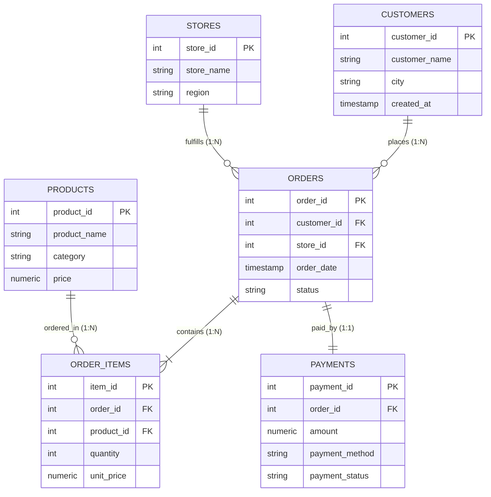

# Agentic AI Analytics: E-Commerce Dataset & Data Dictionary

## 1. Overview & Business Domain

This dataset simulates a high-growth multi-channel Indian e-commerce enterprise operating physical experience hubs and an online marketplace across major metropolitan regions. It is engineered with **relational integrity, realistic business distributions, and financial rigor** for the **Agentic AI Data Analyst** system.

### Key Data Properties
- **Determinism:** Generated using a fixed random seed (`seed=42`) via Python and Faker (`en_IN`). Identical generation on any machine.
- **Geographic Coverage:** Tier-1 and Tier-2 Indian cities (Bengaluru, Mumbai, Delhi, Hyderabad, Chennai, Pune, Kolkata, etc.) mapped to 5 commercial zones (`North`, `South`, `East`, `West`, `Central`).
- **Currency & Pricing:** All monetary amounts are in **Indian Rupees (INR)** and stored using exact `NUMERIC(10, 2)` types to avoid binary floating-point roundoff errors.
- **Customer Segmentation:** Models power-law purchase behavior (the top 20% of customers represent ~60% of total order volume).

---

## 2. Entity Relationship Model & Relational Schema



---

## 3. Data Dictionary

### 3.1 `customers`
Stores customer master demographic profiles.
| Column | Type | Constraints | Description |
| :--- | :--- | :--- | :--- |
| `customer_id` | `SERIAL` / `INT` | `PRIMARY KEY` | Unique customer identifier |
| `customer_name` | `VARCHAR(150)` | `NOT NULL` | Full name of customer |
| `city` | `VARCHAR(100)` | `NOT NULL` | Residential metropolitan city |
| `created_at` | `TIMESTAMPTZ` | `NOT NULL` | Account registration timestamp |

### 3.2 `products`
Active and archived catalog merchandise.
| Column | Type | Constraints | Description |
| :--- | :--- | :--- | :--- |
| `product_id` | `SERIAL` / `INT` | `PRIMARY KEY` | Unique product SKU identifier |
| `product_name` | `VARCHAR(200)` | `NOT NULL` | Commercial product title |
| `category` | `VARCHAR(100)` | `NOT NULL` | Category (`Electronics`, `Apparel`, `Home & Kitchen`, `Grocery`, `Fitness`) |
| `price` | `NUMERIC(10, 2)` | `NOT NULL, CHECK (price > 0)` | Current catalog price in INR |

### 3.3 `stores`
Fulfillment centers and physical retail hubs across regions.
| Column | Type | Constraints | Description |
| :--- | :--- | :--- | :--- |
| `store_id` | `SERIAL` / `INT` | `PRIMARY KEY` | Unique store identifier |
| `store_name` | `VARCHAR(150)` | `NOT NULL` | Store flagship name and neighborhood |
| `region` | `VARCHAR(50)` | `NOT NULL, CHECK IN ('North', 'South', 'East', 'West', 'Central')` | Commercial region |

### 3.4 `orders`
Transactional header tracking order lifecycle.
| Column | Type | Constraints | Description |
| :--- | :--- | :--- | :--- |
| `order_id` | `SERIAL` / `INT` | `PRIMARY KEY` | Unique order transaction ID |
| `customer_id` | `INT` | `NOT NULL, FK -> customers(customer_id) ON DELETE RESTRICT` | Customer who placed order |
| `store_id` | `INT` | `NOT NULL, FK -> stores(store_id) ON DELETE RESTRICT` | Fulfilling store/hub |
| `order_date` | `TIMESTAMPTZ` | `NOT NULL` | Placement timestamp (always after customer creation) |
| `status` | `VARCHAR(20)` | `NOT NULL, CHECK IN ('Completed', 'Pending', 'Cancelled')` | Order fulfillment state |

### 3.5 `order_items`
Granular line items within each order header.
| Column | Type | Constraints | Description |
| :--- | :--- | :--- | :--- |
| `item_id` | `SERIAL` / `INT` | `PRIMARY KEY` | Unique order item identifier |
| `order_id` | `INT` | `NOT NULL, FK -> orders(order_id) ON DELETE CASCADE` | Associated order |
| `product_id` | `INT` | `NOT NULL, FK -> products(product_id) ON DELETE RESTRICT` | Purchased product SKU |
| `quantity` | `INT` | `NOT NULL, CHECK (quantity > 0)` | Units purchased |
| `unit_price` | `NUMERIC(10, 2)` | `NOT NULL, CHECK (unit_price > 0)` | **Historical snapshot price** at purchase |

### 3.6 `payments`
Financial settlement ledger for each order.
| Column | Type | Constraints | Description |
| :--- | :--- | :--- | :--- |
| `payment_id` | `SERIAL` / `INT` | `PRIMARY KEY` | Unique payment record ID |
| `order_id` | `INT` | `NOT NULL, FK -> orders(order_id) ON DELETE CASCADE` | Associated order |
| `amount` | `NUMERIC(10, 2)` | `NOT NULL, CHECK (amount >= 0)` | Settled or attempted payment amount |
| `payment_method` | `VARCHAR(50)` | `NOT NULL, CHECK IN ('UPI', 'Credit Card', 'Debit Card', 'Net Banking', 'Cash on Delivery')` | Channel |
| `payment_status` | `VARCHAR(20)` | `NOT NULL, CHECK IN ('Success', 'Pending', 'Failed', 'Refunded')` | Settlement status |

---

## 4. Business Metrics & Accounting Rules

### 4.1 Definition of Recognized Revenue
In this system, **Recognized Revenue** is defined as:
$$\text{Total Completed Revenue} = \sum_{\text{orders.status} = \text{'Completed'}} (\text{order\_items.quantity} \times \text{order\_items.unit\_price})$$
- Orders with `status = 'Pending'` represent uncommitted pipelines and are **excluded** from revenue.
- Orders with `status = 'Cancelled'` are **excluded** from revenue.

### 4.2 Accounting Treatment of Refunds
- When an order is cancelled after payment settlement, the order's `status` becomes `'Cancelled'`, and its associated payment record reflects `payment_status = 'Refunded'`.
- Because revenue is strictly conditioned on `orders.status = 'Completed'`, refunded transactions are naturally prevented from inflating gross or net revenue figures.

### 4.3 Preservation of Historical Unit Prices
A fundamental database design rule implemented in `order_items`:
- **Never compute historical revenue by joining directly to `products.price`!**
- Catalog prices fluctuate over time (due to inflation, sales, price hikes).
- `order_items.unit_price` captures the exact price agreed upon at the exact timestamp of transaction execution, ensuring immutable financial auditing.

### 4.4 Intentional Reconciliation Anomalies
To test SQL auditing, anomaly detection, and agent self-correction, two intentional discrepancies are embedded in the dataset:
1. **Order ID 100:** `status = 'Completed'`, but recorded `payments.amount` is half of the calculated line item sum (partial capture discrepancy).
2. **Order ID 250:** `status = 'Completed'`, but `payments.payment_status` remains stuck as `'Pending'` (settlement sync discrepancy).

---

## 5. How to Regenerate and Seed the Data

To regenerate fresh synthetic data files and reload the database:

```powershell
# 1. Regenerate data and recreate sql/seed.sql
.\.venv\Scripts\python scripts/generate_data.py

# 2. Reset database schema and seed data
.\.venv\Scripts\python scripts/load_data.py --reset

# 3. Validate data integrity and financial consistency
.\.venv\Scripts\python scripts/validate_data.py

# 4. Run automated test suite
.\.venv\Scripts\pytest -v tests/test_data_integrity.py
```
